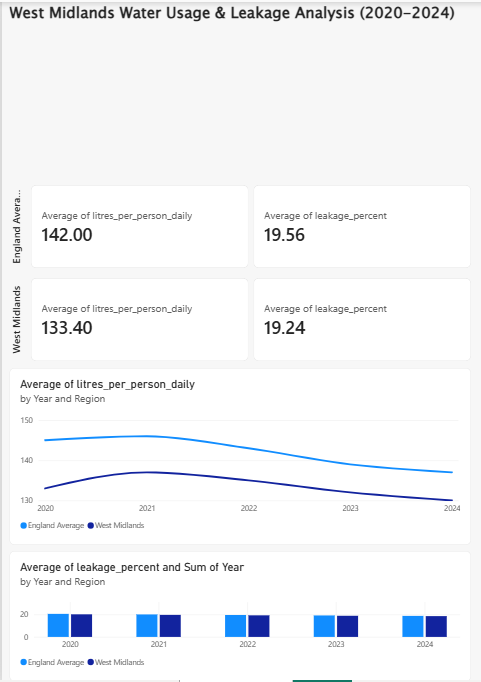

# west-midlands-water-usage-analysis
Comparing daily household water use and leakage rates for Severn Trent (West Midlands) against the England average from 2020 to 2024.

## Summary
* West Midlands daily usage averaged **132.4 litres per person**, lower than the England average of **142.0 litres**.
* Usage in the region dipped slightly from **133L** in 2020 to **130L** in 2024.
* Leakage improved each year, falling from **20.3%** in 2020 down to **18.5%** in 2024.

## Files
* `water_analysis.sql` - SQL queries used to group and compare regional figures
* `West_Midland_Water.csv` - 2020–2024 dataset
* `West_Midland_Water_Dashboard.pbix` - Power BI report
